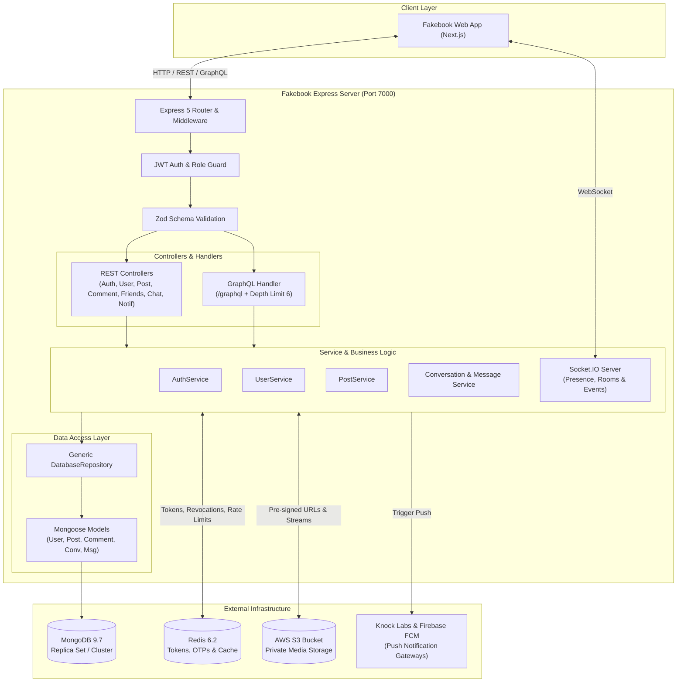
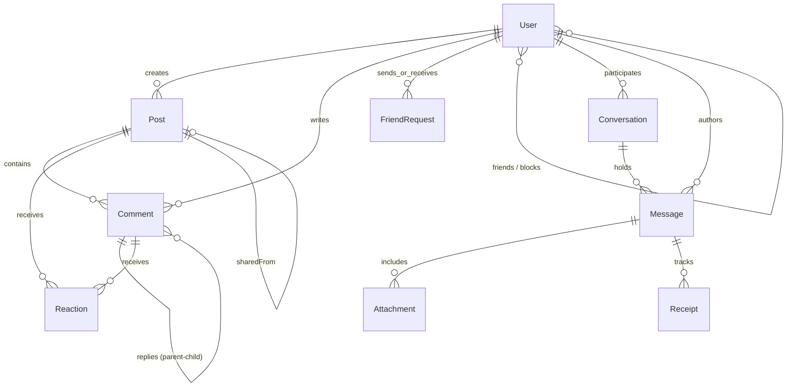

# Fakebook — Core Social API & Real-Time Engine

[](https://nodejs.org/)
[](https://expressjs.com/)
[](https://www.typescriptlang.org/)
[](https://mongoosejs.com/)
[](https://redis.io/)
[](https://socket.io/)
[](https://graphql.org/)
[](https://aws.amazon.com/s3/)
[](https://vitest.dev/)

A robust, enterprise-grade monolithic backend service powering the **Fakebook** social platform. Built with **Express 5**, **TypeScript**, **MongoDB (Mongoose)**, **Redis**, and **Socket.IO**, it provides a dual API surface (**REST** and **GraphQL**), real-time messaging, multi-channel notifications (Knock Labs and FCM), private S3 media streaming, and cryptographic data protection at rest.

> **Frontend Application:** Companion client repository built with Next.js 16: [Fakebook Frontend](https://github.com/Mostafa3lyan/fakebook-social-app-nextjs.git).

---

## Table of Contents

- [Overview](#overview)
- [Key Features](#key-features)
- [System Architecture](#system-architecture)
  - [Layered Pattern & Generic Repository](#layered-pattern--generic-repository)
  - [Dual API Strategy (REST & GraphQL)](#dual-api-strategy-rest--graphql)
  - [Object Storage & Media Streaming Pipeline](#object-storage--media-streaming-pipeline)
  - [Real-Time WebSocket Gateway](#real-time-websocket-gateway)
  - [Authentication & Security Controls](#authentication--security-controls)
- [Database Schema & Conceptual Model](#database-schema--conceptual-model)
- [Technology Stack](#technology-stack)
- [Project Structure](#project-structure)
- [Getting Started](#getting-started)
  - [Prerequisites](#prerequisites)
  - [Installation](#installation)
  - [Environment Configuration](#environment-configuration)
  - [Development Server](#development-server)
  - [Production Build & Execution](#production-build--execution)
- [Testing & Quality Assurance](#testing--quality-assurance)
- [API Reference](#api-reference)
  - [REST Endpoints Summary](#rest-endpoints-summary)
  - [GraphQL Schema Capabilities](#graphql-schema-capabilities)
  - [Socket.IO Event Specifications](#socketio-event-specifications)
- [Roadmap](#roadmap)
- [License](#license)

---

## Overview

The Fakebook Core API serves as the centralized backend service orchestrating social interactions, persistent state, media pipelines, and real-time delivery. Key engineering principles include:

1. **Strict Type Safety & Runtime Validation:** End-to-end TypeScript 5.8 with comprehensive Zod schemas validating request parameters, query strings, headers, and multipart form bodies prior to service execution.
2. **Defensive Data Architecture:** Multi-layered Mongoose schemas supporting automated soft deletes (`deletedAt`), optimistic concurrency control (`__v`), compound indexing for high-speed feeds, and AES cipher encryption at rest for sensitive personally identifiable information (PII).
3. **High-Throughput State & Session Management:** Redis-backed token revocation lists, short-lived OTP verification stores, rate limiters, and live connection session tracking.
4. **Private Media Gateways:** Private AWS S3 bucket architecture utilizing direct pre-signed PUT URLs for avatar/cover uploads and server-authenticated streaming pipelines for media retrieval.

---

## Key Features

### 1. Authentication & Identity
- **Multi-Provider Auth:** Traditional email/password with Argon2/Bcrypt hashing alongside Google OAuth 2.0 ID token verification via `google-auth-library`.
- **Two-Factor Authentication (2FA):** User-controlled 2FA enrollment with email OTP challenge verification.
- **Token Lifecycle & Revocation:** Cryptographic JWT access and refresh token pair with Redis-backed revocation (`jti` blocklisting) on logout and transparent rotation.
- **Account Deactivation & Recovery:** Soft-delete deactivation with a 30-day restore window, plus permanent account purge options with cascading relationship cleanup.

### 2. Social Graph Engine
- **Friend Request Lifecycle:** Send, accept, reject, and cancel pending requests with compound index uniqueness preventing duplicates.
- **Relationship Resolution:** High-speed relationship status lookup (`none`, `pending_sent`, `pending_received`, `friends`, `blocked`).
- **Mutual Blocking:** Bidirectional enforcement preventing blocked users from viewing profiles, searching accounts, commenting, or messaging.

### 3. News Feed & Posts
- **Feed Stream:** Chronological feed supporting cursor and page-based pagination.
- **Media Attachments:** Multi-file image uploads (up to 10 attachments) processed via Multer and streamed to AWS S3.
- **Granular Reactions:** 7 reaction types (`like`, `love`, `care`, `haha`, `wow`, `sad`, `angry`) with real-time counters and breakdown caching.
- **Reshared Posts:** Dedicated shared post references linking original authors and source posts, with automatic tombstone detection if original posts are deleted.
- **Audience Privacy:** Granular post visibility scopes (`Public`, `Friends`, `OnlyMe`).

### 4. Hierarchical Comments & Threads
- **Threaded Architecture:** Top-level post comments with nested replies.
- **Rich Media & Reactions:** S3 image attachments and independent reaction breakdowns for comments and replies.
- **Author Controls:** Author-only comment updates and soft deletion preserving conversation thread integrity.

### 5. Real-Time Chat & Messenger Engine
- **Direct & Group Conversations:** 1-on-1 direct conversations and multi-participant group chats with administrator roles.
- **Non-Friend Message Requests:** Automatic gating separating friend chats from unsolicited non-friend messages until accepted.
- **Room Authorization:** Socket.IO room gate verifying membership before allowing socket joins to `conversation:${id}`.
- **Real-Time Presence:** Multi-tab connection tracking via user socket set in Redis/memory emitting online/offline status without flickering.
- **Live Receipts & Typing:** Sent (`✓`), delivered (`✓✓`), and read receipt progression alongside debounced typing indicator broadcasts.
- **Message Operations:** Author-only editing with `(edited)` flags, backward cursor-based pagination, and dual deletion: *Unsend for everyone* vs. *Remove for you*.

### 6. Multi-Channel Notifications
- **Knock Labs Integration:** Workflow orchestration for transactional user notifications and automated delivery channels.
- **Firebase Cloud Messaging (FCM):** Device token registration endpoint (`/notifications/fcm-token`) for dispatching native browser push notifications.
- **In-App Notification Feed:** Paginated notification history with unread count badges and bulk "Mark all as read" operations.

---

## System Architecture



### Layered Pattern & Generic Repository
The server enforces a clean separation of concerns:
- **Routes / Controllers:** Handle HTTP transport, request mapping, status codes, and response wrapping (`successResponse`).
- **Middleware:** Authenticates JWT tokens, validates Zod schemas, enforces role authorizations (`Admin`, `User`), and catches unhandled exceptions via `globalErrorHandler`.
- **Services:** Encapsulate business logic, transactional operations, and inter-service coordination.
- **Repositories:** Abstract database operations via `DatabaseRepository<T>`, providing typed methods for pagination, projections, atomic operations, and soft-delete filtering.

### Dual API Strategy (REST & GraphQL)
- **REST Endpoints:** Serve transactional mutations and standard CRUD operations (creating posts, sending messages, managing friendships, uploading media).
- **GraphQL Endpoint (`/graphql`):** Implemented using `graphql-http` with strict AST depth limiting (`depthLimit(6)`), allowing the client to fetch deeply aggregated feeds and user profile networks in a single round-trip without over-fetching.

### Object Storage & Media Streaming Pipeline
- Assets in the AWS S3 bucket are marked with private ACLs (`ObjectCannedACL.private`).
- Profile avatars and banners leverage pre-signed upload URLs (`PutObjectCommand`), enabling clients to stream large image binaries directly to S3.
- In-feed media and chat attachments are retrieved via the authenticated backend streaming endpoint `/uploads/*path`, which pipelines S3 readable streams directly to HTTP response streams with proper MIME types.

### Real-Time WebSocket Gateway
Built on Socket.IO 4.8, the gateway maintains authenticated socket connections:
- Authenticates clients during the handshake.
- Places each authenticated user in a dedicated room `user:${userId}`.
- Restricts conversation room joins (`conversation:${id}`) to verified participants.
- Broadcasts real-time events (`chat:new_message`, `chat:typing_start`, `chat:typing_stop`, `user:presence`) to authorized sockets only.

### Authentication & Security Controls
- **Password Protection:** Uses Argon2 and Bcrypt with salt rounds configured via environment settings. Stores password history (`oldPasswords`) to prevent reusing recent credentials.
- **Data Encryption at Rest:** Personally identifiable fields like phone numbers are encrypted with an AES cipher (`iv:cipherText`) using a dedicated encryption key.
- **JWT Revocation:** Blacklists tokens in Redis upon logout or credential changes (`changeCredentialsTime`), invalidating older active sessions immediately.

---

## Database Schema & Conceptual Model



### Key Models & Indexing Strategy
- **`UserModel`:** Stores user credentials, AES-encrypted phone numbers, friend ID arrays, blocked user ID arrays, profile visit counters, and 2FA flags. Indexed by unique email.
- **`PostModel`:** Stores content, visibility enum, S3 attachment keys, friend tags, location data, reaction breakdown maps, and share references. Indexed by `createdBy` and `createdAt` for feed sorting.
- **`CommentModel`:** Supports parent comment self-references (`commentId`) for nested replies. Compound index on `{ postId: 1, commentId: 1, createdAt: -1 }`.
- **`FriendRequestModel`:** Tracks pending, accepted, and rejected requests. Unique compound index `{ sender: 1, receiver: 1 }` prevents duplicate requests in the same direction.
- **`ConversationModel`:** Manages 1-on-1 and group chat rooms, participant arrays, roles (`admin`, `member`), last message references, and acceptance statuses.
- **`MessageModel`:** Stores message text, attachment metadata, author references, deletion status (`everyone` tombstone vs. hidden arrays), and read receipt arrays. Compound index on `{ conversationId: 1, createdAt: -1 }`.

---

## Technology Stack

| Category | Technology | Version | Purpose |
| :--- | :--- | :--- | :--- |
| **Runtime** | Node.js | `>=20.x` | JavaScript runtime environment |
| **Language** | TypeScript | `5.8.2` | Static typing and compiler |
| **Framework** | Express | `5.2.1` | Native async HTTP router & middleware pipeline |
| **Database** | MongoDB / Mongoose | `9.7.1` | NoSQL document database and ODM |
| **Cache & Store** | Redis | `6.2.0` | Token revocation, OTP storage, and rate limiting |
| **Real-Time** | Socket.IO | `4.8.4` | WebSocket bi-directional event gateway |
| **GraphQL** | GraphQL / graphql-http | `17.0.2` / `1.23.1` | Aggregated data query surface |
| **Cloud Storage** | AWS SDK v3 S3 | `^3.1117.0` | Media storage, pre-signed URLs, and streaming |
| **Notifications** | Knock Labs Node SDK | `^1.34.0` | Notification workflow orchestration |
| **Web Push** | Firebase Admin SDK | `^14.3.0` | Server-side FCM push dispatching |
| **Security** | Argon2 & Bcrypt | `0.44.0` / `6.0.0` | Password and OTP hashing algorithms |
| **Tokens** | JSONWebToken | `9.0.3` | Cryptographic JWT signing and decoding |
| **OAuth** | Google Auth Library | `11.0.2` | Google ID token verification |
| **Validation** | Zod | `4.4.3` | Schema definition and runtime validation |
| **File Uploads** | Multer | `2.2.0` | Multipart form-data handling |
| **Email** | Nodemailer | `10.1.0` | Transactional email & OTP delivery |
| **Testing** | Vitest & Supertest | `3.0.7` / `7.3.2` | Unit and integration test suites |

---

## Project Structure

```
s11-social-app/
├── src/
│   ├── app.bootstrap.ts                # Application initialization, middleware, and route mounting
│   ├── main.ts                         # Server entry point
│   ├── common/                         # Shared utilities, enums, and interfaces
│   │   ├── enums/                      # Visibility, Roles, Reactions, Message types
│   │   ├── exceptions/                 # Custom HTTP exception hierarchy
│   │   ├── interfaces/                 # Core domain entity interfaces
│   │   ├── response/                   # Standardized response envelopes
│   │   ├── services/                   # Redis, S3, Socket, Knock, and Token services
│   │   ├── types/                      # Decoded token types and utilities
│   │   └── utils/                      # Encryption, Multer, and security helpers
│   ├── config/                         # Environment configuration service
│   ├── DB/                             # Database persistence layer
│   │   ├── connection.db.ts            # Mongoose MongoDB connection handler
│   │   ├── models/                     # User, Post, Comment, FriendRequest, Conversation, Message
│   │   └── repository/                 # Generic DatabaseRepository<T> abstraction
│   ├── middleware/                     # Authentication, Authorization, Validation, Global Error
│   └── modules/                        # Feature-based business modules
│       ├── auth/                       # Signup, login, 2FA, OTPs, magic links
│       ├── comment/                    # Hierarchical comments, replies, and reactions
│       ├── conversation/               # Chat conversations, group settings, message requests
│       ├── friends/                    # Friend requests, friends lists, relationship checks
│       ├── graphql/                    # Root schema, query/mutation types, depth limiting guard
│       ├── message/                    # Chat messages, editing, unsending, receipts
│       ├── notifications/              # In-app notifications, FCM token management
│       ├── post/                       # Post CRUD, feeds, visibility, reactions
│       └── user/                       # User profiles, blocking, S3 avatars, account deletion
└── tests/                              # Automated test suites (Vitest)
    ├── setup.ts                        # Test environment initialization
    ├── unit/                           # Model & Zod validation unit tests
    └── integration/                    # REST API & live chat flow integration tests
```

---

## Getting Started

### Prerequisites
- **Node.js**: Version `20.x` or later
- **MongoDB**: Version `6.x` or later (local instance or cloud cluster)
- **Redis**: Version `6.x` or later
- **AWS S3 Bucket**: With appropriate IAM read/write permissions
- **Knock Labs Account** & **Firebase Project**: Optional for push notifications

### Installation
Clone the backend repository and install dependencies:

```bash
git clone https://github.com/Mostafa3lyan/s11-social-app.git
cd s11-social-app
npm install
```

### Environment Configuration
The application reads environment variables based on `NODE_ENV` (e.g., `.env.development` or `.env.production`). Configure your local environment file with the following variables:

| Variable Name | Required | Example Placeholder | Description |
| :--- | :---: | :--- | :--- |
| `PORT` | No | `7000` | HTTP port on which the server listens. |
| `APP_NAME` | No | `Fakebook` | Application identifier. |
| `DB_URI` | **Yes** | `mongodb://localhost:27017/fakebook` | MongoDB connection connection URI. |
| `REDIS_URI` | **Yes** | `redis://localhost:6379` | Redis connection URI for caching and token blocklists. |
| `SALT_ROUND` | No | `10` | Salt rounds for password hashing. |
| `ENC_SECRET_KEY` | **Yes** | `your_32_byte_aes_encryption_key` | Secret key used for AES phone number encryption at rest. |
| `Encryption_ALGORITHM` | **Yes** | `aes-256-cbc` | Cipher algorithm used for data encryption. |
| `ACCESS_TOKEN_SECRET_KEY` | **Yes** | `your_access_token_secret` | HMAC secret for signing short-lived access JWTs. |
| `REFRESH_TOKEN_SECRET_KEY` | **Yes** | `your_refresh_token_secret` | HMAC secret for signing long-lived refresh JWTs. |
| `ACCESS_TOKEN_EXPIRES_IN` | No | `1800` | Access token lifespan in seconds (default: 30 minutes). |
| `REFRESH_TOKEN_EXPIRES_IN` | No | `31536000` | Refresh token lifespan in seconds (default: 1 year). |
| `GOOGLE_CLIENT_ID` | No | `your_google_oauth_client_id` | Google Client ID for verifying Google Sign-In tokens. |
| `EMAIL_USER` | No | `notifications@example.com` | SMTP email address for sending OTPs and magic links. |
| `EMAIL_APP_PASSWORD` | No | `your_smtp_app_password` | SMTP authentication credential. |
| `MAGIC_LINK_SECRET` | **Yes** | `your_magic_link_token_secret` | Secret key for signing password reset magic links. |
| `CLIENT_URL` | No | `http://localhost:5173` | Frontend application origin for magic link redirects. |
| `AWS_BUCKET_NAME` | **Yes** | `your-s3-bucket-name` | Amazon S3 bucket name for uploads. |
| `AWS_REGION` | **Yes** | `us-east-1` | Amazon Web Services region. |
| `AWS_ACCESS_KEY_ID` | **Yes** | `your_aws_access_key` | AWS IAM access key ID. |
| `AWS_SECRET_ACCESS_KEY` | **Yes** | `your_aws_secret_key` | AWS IAM secret access key. |
| `KNOCK_API_KEY` | No | `your_knock_api_key` | Knock Labs service API key. |
| `KNOCK_IN_APP_CHANNEL_ID`| No | `your_knock_in_app_channel_id` | Knock in-app notification feed channel identifier. |

> [!WARNING]
> Never commit actual credentials, database passwords, or secret keys to version control. Keep `.env.*` files listed in `.gitignore`.

### Development Server
Run the TypeScript compiler in watch mode alongside the development server:

```bash
npm run start:dev
```

### Production Build & Execution
Compile the TypeScript source code to `./dist` and start the production process:

```bash
# Compile TypeScript to JavaScript
npm run build

# Run production server
npm run start:prod
```

---

## Testing & Quality Assurance

Fakebook includes automated test suites powered by **Vitest** and **Supertest**, covering validation schemas, database models, REST endpoints, and end-to-end chat flows.

```bash
# Run test suite once
npm test

# Run tests in watch mode
npm run test:watch
```

### Verified Test Results:
- **`tests/unit/models.test.ts`**: Verifies Mongoose schema constraints, virtual fields, and defaults (6 tests passed).
- **`tests/unit/validation.test.ts`**: Verifies Zod validation parsing, payload coercion, and parameter guards (25 tests passed).
- **`tests/integration/api.test.ts`**: Verifies healthcheck endpoints and REST routing (9 tests passed).
- **`tests/integration/chat-flow.test.ts`**: Verifies conversation creation, message persistence, cursor pagination, and unread counters (7 tests passed).
- **Total:** **47 passing tests, 0 failed.**

---

## API Reference

### REST Endpoints Summary

#### Authentication (`/auth`)
- `POST /auth/signup`: Register new account with email, password, and profile details.
- `POST /auth/login`: Authenticate credentials and receive access and refresh token pair.
- `POST /auth/signup/gmail`: Authenticate or register using a Google OAuth ID token.
- `POST /auth/login-confirm`: Submit 2FA verification OTP during sign-in.
- `PATCH /auth/confirm-email`: Confirm email address using 6-digit verification code.
- `PATCH /auth/resend-confirm-email`: Request a new email confirmation OTP.
- `POST /auth/forgot-password`: Dispatch password reset OTP and magic link.
- `POST /auth/verify-otp`: Validate password reset OTP.
- `GET /auth/verify-link`: Validate magic link token.
- `PATCH /auth/reset-password`: Update password using verified reset token.
- `PATCH /auth/request-2fa`: Request OTP to enable two-factor authentication.
- `PATCH /auth/enable-2fa`: Activate two-factor authentication with valid code.
- `PATCH /auth/disable-2fa`: Deactivate two-factor authentication with valid code.

#### User & Settings (`/user`)
- `GET /user`: Retrieve authenticated user's profile.
- `PATCH /user/profile`: Update profile information (name, bio, location).
- `GET /user/search`: Search users by name or query string.
- `GET /user/:userId/share-profile`: Public profile view with visitor tracking.
- `PATCH /user/profile-image`: Request pre-signed S3 URL for avatar upload.
- `DELETE /user/remove-profile-image`: Remove current avatar.
- `PATCH /user/profile-cover-image`: Request pre-signed S3 URL for cover photo upload.
- `DELETE /user/remove-profile-cover-image`: Remove cover photo.
- `PATCH /user/change-password`: Update password with history verification.
- `GET /user/blocked`: List blocked users.
- `POST /user/block/:targetUserId`: Block a target user.
- `DELETE /user/unblock/:targetUserId`: Unblock a target user.
- `POST /user/rotate-token`: Exchange refresh token for fresh access credentials.
- `POST /user/logout`: Revoke active session tokens in Redis.
- `DELETE /user/soft-delete`: Deactivate account with 30-day restore period.
- `PATCH /user/restore-account`: Restore deactivated account within grace window.
- `DELETE /user/delete-account`: Permanently delete account and cascade cleanup.

#### Friendships (`/friends`)
- `POST /friends/request/:receiverId`: Send friend request to a user.
- `PATCH /friends/accept/:requestId`: Accept an incoming friend request.
- `PATCH /friends/reject/:requestId`: Reject an incoming friend request.
- `DELETE /friends/cancel/:requestId`: Cancel an outgoing friend request.
- `DELETE /friends/unfriend/:friendId`: Remove a user from friends list.
- `GET /friends/requests/received`: Paginated list of incoming friend requests.
- `GET /friends/requests/sent`: Paginated list of outgoing friend requests.
- `GET /friends/status/:targetUserId`: Check friendship status with a specific user.
- `GET /friends`: List authenticated user's friends.
- `GET /friends/user/:userId`: List friends of any specified user.

#### Posts & Reactions (`/post`)
- `POST /post`: Create post with optional multi-image attachments (up to 10).
- `GET /post`: Chronological feed posts with visibility filtering.
- `GET /post/user/:userId`: Posts authored by a specific user.
- `GET /post/:postId`: Get single post by ID.
- `POST /post/:postId/share`: Share post to personal timeline.
- `PATCH /post/:postId`: Update post content and attachments.
- `POST /post/:postId/react`: React to post (`like`, `love`, `care`, `haha`, `wow`, `sad`, `angry`).
- `DELETE /post/:postId/soft-delete`: Soft delete post.
- `PATCH /post/:postId/restore`: Restore soft-deleted post.
- `DELETE /post/:postId`: Permanently remove post.

#### Comments (`/post/:postId/comment`)
- `POST /`: Add top-level comment to post with optional image attachment.
- `GET /`: List comments for a post.
- `GET /:commentId`: Get specific comment details.
- `PATCH /:commentId`: Update comment text or attachment.
- `POST /:commentId/reply`: Post threaded reply to a comment.
- `GET /:commentId/reply`: List replies for a comment.
- `POST /:commentId/react`: React to comment or reply.
- `DELETE /:commentId`: Delete comment or reply.

#### Messenger & Conversations (`/conversation`)
- `POST /conversation/direct/:recipientId`: Create or retrieve 1-on-1 direct conversation.
- `POST /conversation/group`: Create group conversation with title and member list.
- `GET /conversation`: List user's active conversations (inbox).
- `GET /conversation/requests`: List pending message requests from non-friends.
- `PATCH /conversation/:conversationId/accept-request`: Accept message request.
- `PATCH /conversation/:conversationId/reject-request`: Reject message request.
- `GET /conversation/:conversationId`: Retrieve conversation details.
- `PATCH /conversation/:conversationId`: Update group title or avatar (admin only).
- `POST /conversation/:conversationId/members`: Add group members.
- `DELETE /conversation/:conversationId/members/:memberId`: Remove group member or leave group.
- `DELETE /conversation/:conversationId`: Disband group (admin) or soft-delete conversation.
- `POST /conversation/:conversationId/read`: Mark all messages in conversation as read.

#### Chat Messages (`/conversation/:conversationId/messages`)
- `GET /`: Retrieve paginated message history (backward cursor-based).
- `POST /`: Send message with optional file/image attachments (up to 5).
- `PATCH /:messageId`: Edit message content (author only).
- `DELETE /:messageId`: Delete message (`mode=everyone` tombstone vs `mode=self` hide).

#### Notifications (`/notifications`)
- `GET /notifications`: Retrieve paginated in-app notifications.
- `GET /notifications/unread-count`: Get count of unread notifications.
- `PATCH /notifications/:messageId/read`: Mark single notification as read.
- `PATCH /notifications/read-all`: Mark all notifications as read.
- `POST /notifications/fcm-token`: Register FCM device token for web push.
- `DELETE /notifications/fcm-token`: Unregister FCM device token.

---

### GraphQL Schema Capabilities

The GraphQL endpoint at `/graphql` provides structured, query-cost-protected access to feed and profile data.

```graphql
# Example Query: Fetch News Feed with Authors and Reactions
query GetFeed($page: Int, $limit: Int) {
  posts(page: $page, limit: $limit) {
    data {
      _id
      content
      attachments
      visibility
      reactionsCount
      reactionsBreakdown {
        like
        love
        care
        haha
        wow
        sad
        angry
      }
      createdBy {
        _id
        fullName
        profilePicture
      }
      commentsCount
      createdAt
    }
    total
    totalPages
  }
}
```

---

### Socket.IO Event Specifications

| Event Name | Direction | Payload | Description |
| :--- | :---: | :--- | :--- |
| `chat:join_conversation` | Client -> Server | `{ conversationId }` | Request to join a specific conversation room. |
| `chat:leave_conversation`| Client -> Server | `{ conversationId }` | Request to leave a conversation room. |
| `chat:typing_start` | Client -> Server | `{ conversationId }` | Broadcast typing status to room participants. |
| `chat:typing_stop` | Client -> Server | `{ conversationId }` | Clear typing status in conversation room. |
| `chat:mark_delivered` | Client -> Server | `{ conversationId, messageId }` | Acknowledge receipt of an incoming message. |
| `chat:new_message` | Server -> Client | `{ message }` | Broadcast new message to conversation members. |
| `chat:message_delivered` | Server -> Client | `{ conversationId, messageId, receipt }` | Inform sender that message reached recipient. |
| `chat:message_read` | Server -> Client | `{ conversationId, readerId, readAt }` | Inform room that messages have been read. |
| `chat:message_edited` | Server -> Client | `{ conversationId, message }` | Broadcast edited message content. |
| `chat:message_deleted` | Server -> Client | `{ conversationId, messageId, mode }` | Broadcast message tombstone or deletion. |
| `user:presence` | Server -> Client | `{ userId, isOnline }` | Broadcast real-time presence change. |

---

## Roadmap

- [ ] **WebRTC Signaling Gateway:** Add peer connection signaling for video and audio calls.
- [ ] **Redis Cluster Support:** Enable distributed Redis clustering for large-scale deployments.
- [ ] **Video Processing Pipeline:** AWS MediaConvert integration for transcoded post video uploads.
- [ ] **End-to-End Encryption (E2EE):** Optional encrypted channels for direct 1-on-1 messenger conversations.

---

## License

This project is licensed under the **ISC License**. See the `package.json` file for details.
